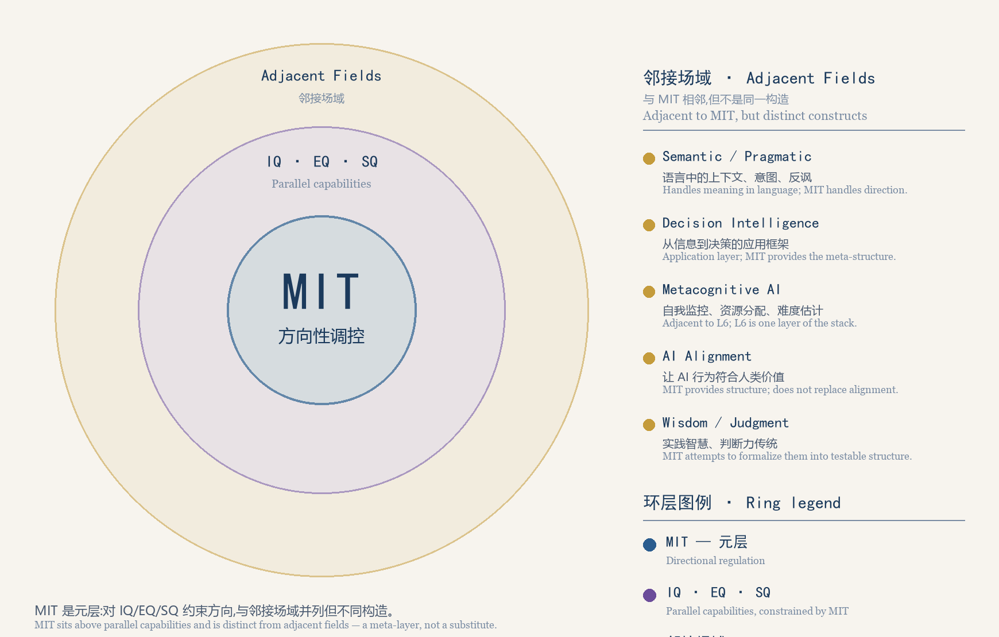

# Meaning Intelligence


> **Meta-Intelligence Theory and Layered Applications**

> Aligned with the canon *Meaning Intelligence: The Cognitive Operating System of Meaning Civilization* V7.0


[](https://msi.gojj.ccwu.cc/)

[](https://github.com/sara-protocol/meaning-intelligence/releases/latest)

[](LICENSE)

[](VERSION.yaml)


---


**Meaning Intelligence is the *directional regulation* of other intelligent activities.** It is not a fourth kind of intelligence standing alongside logical, computational, and perceptual intelligence, but a *meta-layer* above them that constrains their direction. Its question is not *"can it be done"* but *"is it worth doing — worth it for whom, and at what scale?"*


[中文版](README.md)


---

## Research Status

| Dimension | Current status |
|---|---|
| Research phase | `public-research` — 0.x signals research formation, not yet empirically tested |
| Stack evidence level | **2.0 / E0 (conceptual)** — engineering extension, not independently tested or a fixed canon hierarchy |
| White paper | v1.1 (22 pages, bilingual, DOCX + PDF) |
| Version source | [`VERSION.yaml`](VERSION.yaml) — single source of truth for all version numbers |
| Falsification path | [Failure matrix](docs/failure-matrix.md) · [Falsification report template](.github/ISSUE_TEMPLATE/falsification_report.yml) |
| Scholarly commitment | Any module reaching its failure threshold will be **marked or removed**, not defended |

> **On version numbering**: This project uses `0.x` to signal research formation.
> Only after construct validation, a first predictive study, and independent replication
> does it reach `1.0`. This is a deliberate, conservative convention.

---


## What This Theory Does NOT Claim


This theory is most easily misread as a manifesto of the form "AI gives answers, only humans create meaning". It is **not**. To avoid that battlefield, here is an explicit list of its boundaries.


### ❌ This theory does NOT claim


- that humans possess exclusive access to meaning

- that AI cannot participate in meaning processes

- that meaning is subjective preference alone

- that all intelligent systems require human supervision

- that the six-layer stack is the only valid decomposition

- that the theory is empirically confirmed


### ✅ This theory DOES claim


- intelligence requires directional regulation

- meaning judgments can be structurally analyzed

- value and boundary are parts of directional judgment

- multi-scale meaning creates coordination problems

- recursive review may be necessary for long-horizon stability

- the claims above are **testable and falsifiable**


---


## Construct Boundaries


**This project's "Meaning Intelligence" is a specific naming.** As of 2026, `Meaning Intelligence` is already in use across several directions — semantic/pragmatic analysis, decision support, and commercial products among them. This project's **Meaning Intelligence Theory (MI Theory)** refers to **the directional regulation of intelligent activities**. It is not identical to any of the following adjacent constructs.


| Adjacent construct | Concerns | Relation to this project |

|---|---|---|

| **IQ / EQ / SQ** | Can it compute / get along / coexist | Parallel capabilities; this theory **sits above them** to constrain direction |

| **Semantic / Pragmatic Intelligence** | Context, intent, irony, coded subtext in language | Handles **meaning in language**; this theory handles **direction of action** |

| **Decision Intelligence** | Coherent understanding from information + context + human judgment | Application-layer framework; this theory provides the **meta-layer structure** |

| **Metacognitive AI** | Self-monitoring, resource allocation, difficulty estimation | Adjacent to L6; L6 is **one layer of the stack** |

| **AI Alignment** | Aligning AI behavior with human values | Provides **structure for directional judgment**; does not replace alignment research |

| **Wisdom / Judgment traditions** | Practical wisdom, judgment | This theory attempts to **formalize** them into testable structure |


> **Naming conflict statement**: This project does not claim exclusivity over the term `Meaning Intelligence`. We do explicitly distinguish: this project's "Meaning Intelligence Theory" refers to **directional regulation**, which is a **different construct** from same-named usage in semantic, pragmatic, or decision-oriented directions.


---


### Construct Boundary Map



The figure places MIT in a conceptual space: the **inner ring** is MIT itself (a meta-layer for
the directional regulation of intelligent activities); the **middle ring** is IQ / EQ / SQ
(parallel capabilities, constrained by the meta-layer); the **outer ring** is the adjacent
fields (Semantic/Pragmatic, Decision Intelligence, Metacognitive AI, AI Alignment, Wisdom
traditions).

Naming collision is unavoidable — `Meaning Intelligence` is already in use across multiple
directions. This project's **Meaning Intelligence Theory (MI Theory)** refers to **directional
regulation**, which is a **different construct** from same-named usage in semantic, pragmatic,
or decision-oriented directions.


## The Six-Layer Stack


The six layers fall into **three bands** by cognitive distance:


| Band | Layer | Name | Solves |

|---|---|---|---|

| **Interface** | L1 | Cognitive Load Reduction | *Information cannot get in* |

| **Interface** | L2 | Experiential Rendering | *Information cannot get in* |

| **Processing** | L3 | Meaning Generation | *Meaning cannot get out* |

| **Processing** | L4 | Value Assessment | *Meaning cannot get out* |

| **Meta** | L5 | Direction Selection | *Direction cannot be held* |

| **Meta** | L6 | Recursive Reflection and Review | *Direction cannot be held* |


**Only the meta band can rewrite the premises of the layers below it** — this is the formal signature of "meta".


L6's output is written back as L1's input. The six layers form a **closed spiral**, not a one-way pipeline.


> ### Provenance boundary
>
> The six-layer stack, three bands, and MSI implementation are an **engineering extension proposed by this project**, not a fixed hierarchy in the V7.0 canon. The canon's three levels are reinterpreted as a continuous spectrum in Chapter 8; H1–H18 and Appendix D.7 prevail over engineering drafts.

> ### ⚠️ A note on the stack itself

>

> The six-layer stack is an **integrative structure** at evidence level **E0 (conceptual)**. It has not been independently tested. Treat it as a **testable organizing tool**, not a confirmed finding. If a simpler partition with greater explanatory power emerges, it should **replace** this one.


## What's in this Repository


| Directory | Contents |

|---|---|

| `meaning-agent/` | Offline-first deterministic Python agent: exactly six registered skills, bilingual loopback UI, optional LLM adapter, local read-only MCP, tests |

| `web-mcp/` | Public read-only Cloudflare Pages Function: MCP `2025-03-26`, transport tests, publication sync |

| `whitepaper/` | Bilingual public-release white paper v1.1 (22 pages, 9 tables, 3 figures), DOCX + PDF, generation scripts |

| `msi/` | Meaning Intelligence Demonstration System — eight-act Manim animation, single-file interactive page, per-layer screenshots |

| `toolkit/` | 11 fillable checklists derived from Canon Appendix A (A.1–A.10) |

| `docs/` | Architecture, evidence levels, failure matrix, glossary, roadmap, automation governance |

| `tools/` | Zero-dependency publisher, PDF/HTML verifiers, issue-form validator |


## Quick Start

Run the commands below from the repository root. The agent runtime requires Python 3.10+ and only the
standard library; agent UI syntax checks and Web MCP validation require Node.js 20+ and no `npm install`.

### Runnable Meaning Agent

`meaning-agent/` is an offline-first, deterministic agent. It registers **exactly six skills**, returns
bilingual JSON or Markdown, and keeps human approval pending. It does not invent empirical evidence levels.
The skills are part of **operational stack 2.0 at E0**, an engineering extension above Canon V7.0 — not a
fixed canon hierarchy and not independently tested.

```bash
cd meaning-agent
python -m meaning_agent analyze --text "A report claims higher efficiency but gives no source. Should autonomy be preserved?" --offline --json
python -m meaning_agent demo --offline
python -m meaning_agent serve --port 8766
cd ..
```

Open <http://127.0.0.1:8766> for the bilingual local UI; the server binds only to loopback. Without LLM
configuration, results report `mode=offline`. The optional adapter reads only `MI_LLM_BASE_URL`,
`MI_LLM_API_KEY`, and `MI_LLM_MODEL`; it may suggest unverified prose but cannot change deterministic skills,
evidence levels, five-scale aggregation, or approval. A local read-only MCP endpoint is also available:

```bash
cd meaning-agent
python -m meaning_agent mcp --transport http --port 8767
# http://127.0.0.1:8767/mcp
cd ..
```

| Layer | Registered skill | Responsibility |
|---|---|---|
| L1 | `reduce-cognitive-load` | Separate statements from questions and extract structure without verifying facts |
| L2 | `model-experiential-interface` | Suggest parameters and safe local interactive fragments |
| L3 | `map-direction-value-boundary` | Generate direction, value, boundary, and continuous-spectrum candidates |
| L4 | `grade-evidence-falsification` | Preserve E0–E6 boundaries and falsification plans without assigning empirical levels |
| L5 | `calibrate-five-scales` | Recursively calibrate individual, organization, city, nation, and humanity; no weighted summation |
| L6 | `recursive-review-zeroing` | Bounded review, feedback revision, reversible zeroing, and approval reset |

See [`meaning-agent/README.md`](meaning-agent/README.md) for the API, CLI, six reusable skill definitions,
and safety limits.

### Public Read-Only Web MCP

[`web-mcp/functions/api/mcp.js`](web-mcp/functions/api/mcp.js) is a Cloudflare Pages Function using MCP
`2025-03-26`. It exposes six whitelisted bilingual resources and five read-only tools: analysis, review,
resource catalog, evidence levels, and download manifest. A deployed endpoint requires a strong Bearer
`MI_MCP_PUBLIC_TOKEN`; optional `MI_MCP_ALLOWED_ORIGINS` accepts exact origins only. This repository contains
no production endpoint or credentials. The Function never executes input as code and exposes no arbitrary
file, URL, or command access; analysis remains offline and approval remains pending. Publication copies
must be byte-identical to the tracked source.

### White Paper

The bilingual public-release white paper, *Meaning Intelligence: Meta-Intelligence Theory and Layered
Applications*, is **v1.1** (22 pages, 9 tables, 3 figures):
[PDF](whitepaper/dist/意义智能_元智能理论与分层应用_公开发布白皮书_v1.1_中英双语.pdf) ·
[DOCX](whitepaper/dist/意义智能_元智能理论与分层应用_公开发布白皮书_v1.1_中英双语.docx).

```bash
cd whitepaper
python -m pip install python-docx pillow
python make_figures.py
python build_whitepaper.py
cd ..
```

Outputs are in `whitepaper/dist/`. **Do not edit the DOCX directly**; change its generator scripts.

### Publication and Media

- [Publication & media guide (DOCX)](https://msi.gojj.ccwu.cc/download/documents/意义智能_有声读物_发布指南与操作手册_v3.0.docx): publication-package, media-acceptance, and Web MCP operations.
- [v0.2.0 release notes](release_v0.2.0.md), [Claim Registry](docs/claims.md), and [Evidence System](docs/evidence.md): preserve the Canon V7.0 / operational stack 2.0 E0 provenance boundary in public wording.
- Reusable figures are in `whitepaper/figures/`; six-layer demo screenshots are in `msi/screenshots/`. Animation and interfaces are not empirical validation.

### Demonstration System

```bash
# Linux / macOS / Git Bash
cd msi
python -m pip install manim
./run.sh
cd ..
```

```powershell
# Windows PowerShell
cd msi
python -m pip install manim
./run.ps1
cd ..
```

To build only the interactive page without rendering animation, run `python build.py` inside `msi/`; it
uses the planned timeline and labels that fallback explicitly.

### Local Verification

```bash
# Meaning Agent
cd meaning-agent
python -m compileall -q meaning_agent
python -m unittest discover -s tests -v
node --check meaning_agent/static/app.js
cd ..

# Public Web MCP
cd web-mcp
node --test tests/mcp.test.mjs
cd ..

# When the sibling publication root exists, verify byte identity
node web-mcp/scripts/sync-publication.mjs --check "../意义智能有声读物_发布包"

# Existing repository checks
python tools/verify_consistency.py
python tools/verify_issue_forms.py
python tools/verify_planned_fallback.py
python tools/verify_html.py msi/meaning_intelligence.html
```

CI also rebuilds the white paper and MSI page and tests both `--check` and repair synchronization against
an isolated temporary publication copy. It does not render Manim, access the external publication package,
use hosted secrets, or commit generated artifacts.

